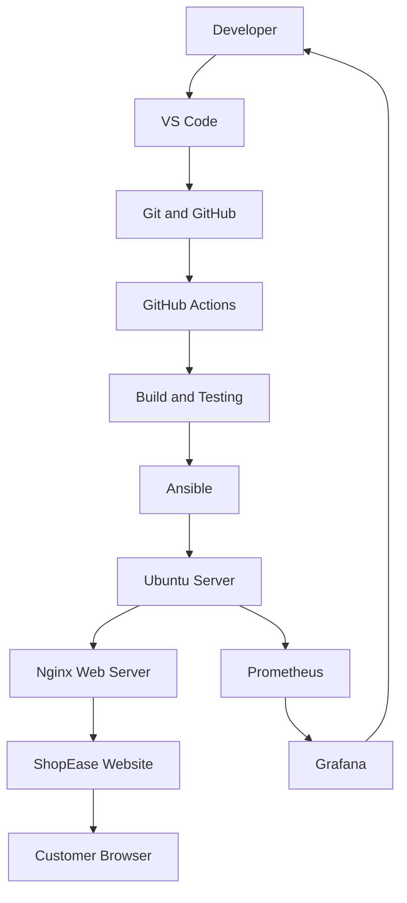

# ShopEase - DevOps Architecture

## 1. Architecture Overview

The ShopEase project demonstrates how DevOps tools and practices can automate the deployment of a web application.

The proposed architecture includes source code management, CI/CD, configuration management, deployment and monitoring.

## 2. Architecture Flow

## 3. Component Description

| Component | Purpose |
|---|---|
| VS Code | Application development |
| Git and GitHub | Version control and source code management |
| GitHub Actions | Proposed CI/CD automation |
| Ansible | Configuration management and automated deployment |
| Ubuntu | Deployment environment |
| Nginx | Web server |
| Prometheus | Proposed infrastructure monitoring |
| Grafana | Proposed monitoring dashboards |

## 4. Practical Implementation Scope

The following components were implemented:

- Ubuntu environment using WSL2.
- Ansible inventory and playbook.
- Nginx installation and configuration.
- ShopEase website deployment.
- Idempotency testing.
- Website modification and redeployment.

GitHub Actions, Prometheus and Grafana are included in the proposed architecture but were not implemented in this practical demonstration.

## 5. Deployment Workflow

1. Developer creates or modifies the website.
2. Source files are maintained in the project repository.
3. Ansible reads the inventory and playbook.
4. Ansible installs and configures Nginx.
5. Website files are copied to the Nginx web directory.
6. Nginx serves the website to customers.
